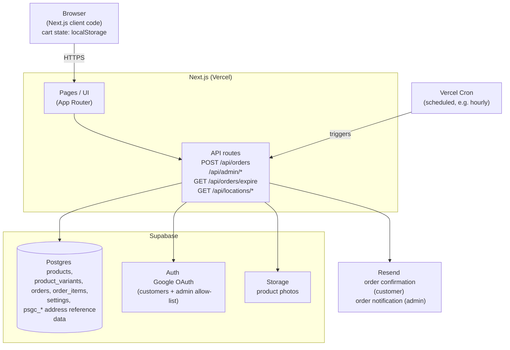
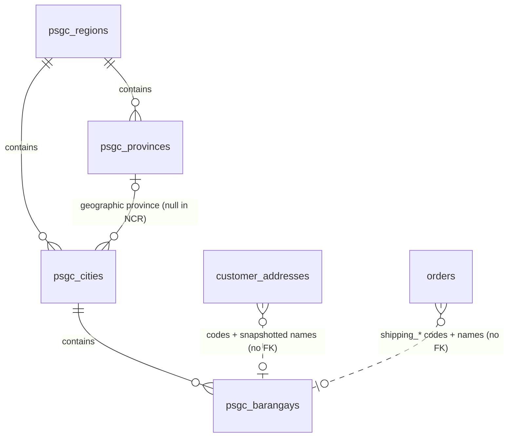
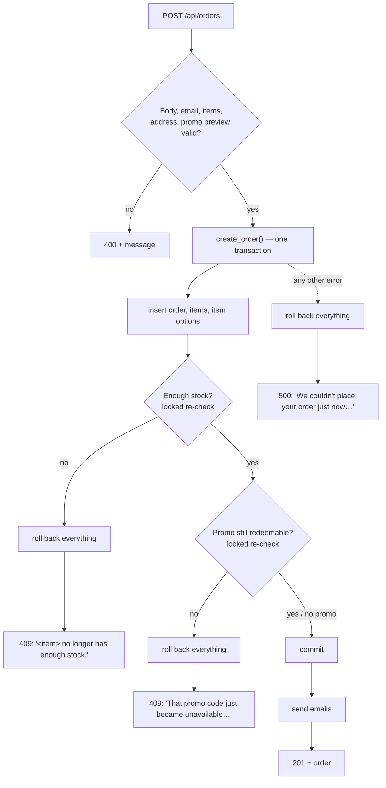
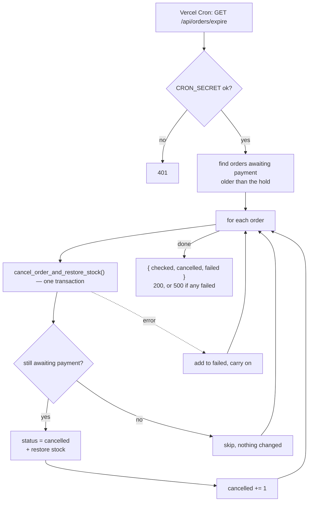

# Target Architecture — Leather Shop

Companion to [PRODUCT_REQUIREMENTS.md](./PRODUCT_REQUIREMENTS.md). That doc
says *what* to build; this one says *how the pieces fit together*. Reflects
the target state — see the end of this doc for what's actually built today
vs. still pending.

## Diagram



## Components

### Next.js (Vercel)
Single codebase, both roles:
- **UI** — App Router pages: home, `/products`, `/products/[slug]`, `/cart`,
  `/checkout`, `/faq`, `/contact`, `/privacy`, `/admin/*`.
- **API layer** — Next.js API routes are the only thing allowed to talk to
  Supabase/Resend directly. The browser never holds a Supabase
  service-role key. Main routes:
  - `POST /api/orders` — validates cart contents against real stock,
    recomputes totals server-side, then writes the order, decrements
    stock and redeems any promo code in one database transaction
    (`create_order()`), and triggers both emails.
  - `GET /api/locations/cities?region=…&province=…` and
    `GET /api/locations/barangays?city=…` — the on-demand halves of the
    checkout/address PSGC dropdowns (see "Delivery area" below). Public,
    read-only, and cached hard (a day in the browser, a week at Vercel's
    edge), since the data only changes when the snapshot is re-seeded.
  - `/api/admin/*` — product CRUD, order status updates, FAQ content edits.
    All gated on the admin allow-list (see Auth below).
  - `GET /api/orders/expire` — the order-hold check (PRD §5, §6): reads
    the configured hold duration from the `settings` table (default 48
    hours — admin-editable, not a code constant), finds orders still
    awaiting payment past that many hours since `created_at`, and cancels
    each one with the `cancel_order_and_restore_stock()` Postgres function
    (status flip and stock restore in one transaction). `GET`, not `POST`,
    because that's what Vercel Cron actually sends. Not otherwise
    user-facing — requires a `CRON_SECRET` bearer token, which Vercel
    attaches automatically once the env var is set; any request without a
    matching token gets a 401.

### Scheduler (Vercel Cron)
There's no long-running server process to just leave a timer on, so the
expiry check needs something external triggering it periodically —
a Vercel Cron Job (defined in `vercel.json`) calling
`GET /api/orders/expire` on a fixed schedule (e.g. hourly). That
schedule interval is a deploy-time config (`vercel.json`), separate from
the admin-configurable hold *duration* the route checks against — changing
how often the check runs still needs a deploy, changing how long the hold
lasts does not. Supabase's `pg_cron` is the alternative if the check
should live in the database instead of the app.

### Supabase
One integration covering three concerns, chosen specifically to avoid
standing up three separate services:

- **Postgres** — the actual database. Tables: `products`, `option_types`,
  `orders`, `order_items` (see Data Model below). Replaces the hardcoded
  product list and in-memory order array that exist today.
- **Auth** — Google OAuth for both customer accounts (order history, per
  PRD §6) and admin access (same login mechanism, but gated by an email
  allow-list rather than a separate credential system — see PRD §6 Admin).
  The allow-list itself is the `admin_users` table (RLS default-deny,
  service-role-only read). `src/proxy.ts` (Next.js 16 renamed
  `middleware.ts` to `proxy.ts`) checks every `/admin/*` request: no
  session → redirect to `/login`; session but email not in `admin_users`
  → redirect to `/login?error=unauthorized`.
- **Storage** — product photos, served via Supabase's CDN, referenced by
  URL from the `product_photos` table.

### Resend
Fired from inside `POST /api/orders` after a successful order write:
- Customer-facing order confirmation, to the address they typed at checkout.
- Admin order-notification alert, to the shop owner's email.

No API key configured → the call no-ops with a console warning instead of
failing the order (already true in the current placeholder implementation).

## Data Model (target)

```
products
  id, slug, name, description, category_id (fk), price_centavos,
  lead_time_days, ordering_enabled, created_at,
  stock_quantity (a single production-capacity number for the whole
  product — all v1 products are made-to-order, so it's the same
  regardless of which option combination a customer picks; not per
  variant — see PRODUCT_OPTIONS_DESIGN.md's "Course correction"),
  in_stock (derived: stock_quantity > 0),
  visible (migration `0012_product_visibility.sql`, default true — admin
  toggle to hide a product from the shop listing/sitemap/search entirely,
  its PDP 404s; distinct from ordering_enabled, which still lists the
  product but shows it as unavailable. getProducts() filters to
  visible=true; getProductBySlug() deliberately doesn't, since order
  history needs to resolve a since-hidden product's photo — the PDP and
  checkout route check product.visible themselves)

categories
  id, name (unique) — normalizes what was a free-text products.category
  column (migration `0014_categories.sql`). Internal-only: no storefront
  browsing/filtering by category, the shop page stays a flat grid; exists
  purely so promo codes (and future admin tooling) reference a real id
  instead of a typo-prone string. Managed at `/admin/categories`.

option_types
  id, name (e.g. "Color", "Thread Color", "Size" — unique, shop-wide),
  display_style ("buttons" | "dropdown", admin-chosen per option type —
  US-39, and global to the type, not per-product — US-40)

  > **Implemented in code, not yet live** — migration
  > `0011_option_library_and_order_item_options.sql` written, not yet run
  > (see MANUAL_TASKS.md; must run after `0010`). Replaces the old
  > per-product `product_option_types` (migration `0009`) — an admin
  > defines "Color" once and attaches it to any product, instead of
  > recreating the same type/value list by hand on every product (see
  > PRODUCT_OPTIONS_DESIGN.md's "Third course correction").

option_values
  id, option_type_id (fk), value (e.g. "Black"), position (shop-wide
  display order)

  > **Implemented in code, not yet live** — see option_types above.
  > Replaces the old per-product `product_option_values`.

product_options
  id, product_id (fk), option_type_id (fk), position — which option
  types a given product uses, and in what order

  > **Implemented in code, not yet live** — the per-product attachment
  > link (new in `0011`; no equivalent existed before this correction).

product_option_selections
  product_option_id (fk), option_value_id (fk) — the per-product subset
  of that type's values this product actually offers (attaching a shared
  type doesn't expose every value it's ever had — the admin picks a
  subset per product)

  > **Implemented in code, not yet live** — new in `0011`. No DB
  > constraint enforces that option_value_id belongs to the same
  > option_type_id as its product_options row, checked in app code
  > (src/lib/admin/catalog.ts).

promo_codes
  id, code (unique), discount_percent, max_discount_centavos,
  min_order_value_centavos, usage_limit_total, starts_at, expires_at,
  active, limit_one_per_customer (default true; false lets a code be
  reused by the same customer, e.g. one shared publicly — the total
  usage_limit_total cap still applies regardless) — admin-authored
  discount codes (docs/IMPROVEMENTS.md's "Promo code capability"), managed
  one at a time at `/admin/promo-codes`. min_order_value_centavos is
  checked against the shopper's whole cart even when the code is
  category-restricted below.

  > `0015_promo_codes.sql` and `0016_promo_code_limit_one_per_customer.sql`
  > (the latter still not yet run, see MANUAL_TASKS.md).

promo_code_categories
  promo_code_id (fk), category_id (fk) — optional category restriction;
  no rows for a code = applies to the whole order. When restricted, the
  code discounts only the eligible items' subtotal (not the whole cart) —
  a mixed cart with only some items in an eligible category still gets a
  partial discount, it isn't rejected outright.

promo_code_redemptions
  id, promo_code_id (fk), customer_email, order_id (fk), redeemed_at —
  one row per successful redemption (not a counter), so the per-customer
  (one redemption per email, unless limit_one_per_customer is false) and
  total-cap rules are checked against real history. Enforced atomically by
  the `redeem_promo_code()` Postgres function (row-locks the promo_codes
  row and re-checks active/dates, per-customer and the total cap), called
  inside `create_order()`'s transaction at order-creation time —
  src/lib/promo-codes.ts's validatePromoCode() does a non-atomic preview
  check first (for the cart/checkout "Apply" button), but
  redeem_promo_code() is the actual enforcement. customer_email is
  compared case-insensitively and stored lowercased (migration 0026's
  trigger does this for orders.customer_email too, so My Account finds an
  order however the shopper capitalised their email).

orders
  id, status ("pending_payment" | "payment_details_sent" | "paid" |
  "shipped" | "cancelled"), status_updated_at (nullable; single shared
  timestamp for whichever status-changing action happened most recently —
  payment details sent, mark paid, mark shipped, or cancel — overwritten
  each time rather than tracked per status/event; null until the first
  one happens), customer_name, customer_email, customer_phone,
  shipping_street, shipping_address2, shipping_barangay, shipping_city,
  shipping_province, shipping_region, shipping_postal_code,
  shipping_region_code, shipping_province_code, shipping_city_code,
  shipping_barangay_code (the PSGC codes and names are snapshotted at
  order time, migration `0025`, so a later PSGC refresh never rewrites a
  past order; province is null for Metro Manila, and every PSGC column is
  null on orders placed before nationwide delivery), subtotal_centavos,
  shipping_centavos, promo_code_id (fk, nullable), discount_centavos
  (snapshot at order time, same reasoning as unit_price_centavos — a
  later edit/deactivation of the code shouldn't rewrite a past order's
  displayed total), total_centavos, created_at

  > `payment_details_sent` is a status between pending_payment and paid —
  > the admin-triggered "payment details" email (docs/IMPROVEMENTS.md)
  > advances an order into it; markOrderPaid, cancelOrderAndRestoreStock,
  > and the order-expiry job all treat it the same as pending_payment
  > (still awaiting payment). Added in
  > `0021_orders_status_tracking.sql`, run against the dev DB (see
  > MANUAL_TASKS.md).

order_items
  id, order_id (fk), product_id (fk), quantity,
  unit_price_centavos (snapshot at order time)

order_item_options
  id, order_item_id (fk), option_type_name (text, snapshot), option_value
  (text, snapshot), position — the option values selected for this order
  item, recorded directly rather than resolved through a variant row; both
  columns are snapshotted at order time so a later option rename/delete
  doesn't rewrite historical order display, same reasoning as
  unit_price_centavos above

  > **Implemented in code, not yet live** — new in `0011`. Replaces
  > order_items.variant_id/variant_label and the product_variants/
  > product_variant_options tables entirely (see PRODUCT_OPTIONS_DESIGN.md's
  > "Second course correction"): any combination of a product's own option
  > values is orderable, with no admin-created variant row gating which
  > combinations are allowed.

payment_methods
  id, label, account_name, account_number, qr_image_url (nullable — a QR
  code is per entry, not one shared image, since one entry's QR is
  independent of another's), position. One flat, admin-orderable list —
  no bank-vs-e-wallet distinction (a `type` column existed briefly, see
  below). Admin-authored, shop-wide content for the "Send payment
  details" email (docs/IMPROVEMENTS.md), managed at
  `/admin/payment-methods`. Default-deny RLS, same as categories/faq_items.

  > `0019_payment_methods.sql` added the table with a `type
  > IN ('bank','ewallet')` column; `0020_payment_methods_drop_type.sql`
  > drops it — the distinction turned out not to matter, and the table
  > was still empty in production at that point so there was no data to
  > migrate. Both run against the dev DB.

customer_addresses
  id, user_email, label, recipient_name, phone, street, address2,
  barangay, city, province, region, postal_code, region_code,
  province_code, city_code, barangay_code, is_default — saved shipping
  addresses (Phase 8), scoped to the logged-in customer's email in app
  code. Same PSGC code + name snapshot as orders (migration `0025`).
  Checkout only offers addresses that carry PSGC codes; rows saved before
  nationwide delivery (dev only) have none and aren't offered.

psgc_regions / psgc_provinces / psgc_cities / psgc_barangays
  Read-only PSA reference data (migration `0025`, seeded by
  `supabase/psgc/seed.mjs`). code (10-digit PSGC, text) + name on each;
  provinces and cities carry region_code; cities carry a nullable
  province_code (their *geographic* province: highly urbanized cities
  like Cebu City are filed under the province they sit in; null only in
  NCR), kind (city/municipality) and city_class (HUC/ICC/CC); barangays
  carry city_code and sub_municipality (the City of Manila's districts).
  provinces also include PSA's two province-level groupings that aren't
  provinces ("City of Isabela", BARMM's "Special Geographic Area").
  Default-deny RLS; read server-side only.

settings
  key, value — single-row or key/value table holding admin-editable shop
  config: shipping_fee_centavos (one flat fee nationwide),
  admin_notification_email,
  order_payment_hold_hours (default 48), payment_instructions_text
  (free-form text shown in the payment details email, alongside the
  payment_methods list above). Read by /api/orders, /api/orders/expire,
  and the checkout UI; written only via /api/admin/*.
```

`unit_price_centavos` is snapshotted onto the order item at order time so a
later price change on the product doesn't rewrite historical order totals.
`settings` is what makes §6/§7's "no hardcoded business configuration"
requirement real — every value in it is what a config constant would
otherwise have held.

## Delivery area (nationwide, PSGC)

Delivery is **always nationwide**: any Philippine address can order, at
the one flat `settings.shipping_fee_centavos`. There's no delivery-area
setting. That's a deliberate exception to the "configurable by default"
rule (owner's decision, 2026-10-15), noted at the validation point in
`src/app/api/orders/route.ts`.

Addresses are entered as cascading region → province → city/municipality
→ barangay dropdowns built from the PSA's **Philippine Standard
Geographic Code**. The data is a bundled snapshot (`supabase/psgc/`,
currently PSA's 2Q 2026 release) seeded into four reference tables. It's
not a live third-party API. Regions and provinces load with the page.
Cities and barangays load per selection, so the ~42k barangays never ship
to the browser. Refreshing to a newer PSA release means re-running the
seed script, with no migration (see `supabase/psgc/README.md`).



Every address save and every order runs the submitted codes through
`resolveAddressCodes()` (`src/lib/psgc.ts`). It checks that the barangay
is in the city, the city is in the province (or has none, for NCR), and
the province is in the region. Then it snapshots the PSGC names onto the
row. Names are never taken from the client.

## Request flow: placing an order

1. Browser: cart lives in `localStorage`, nothing server-side yet.
2. Checkout form submits → `POST /api/orders` with cart contents + shipping
   info.
3. API route (validation, nothing written yet): rejects a malformed body
   or an invalid email (400), lowercases the email, re-fetches each
   product from Supabase (never trusts client-submitted prices), checks
   options, quantity and ordering-enabled, validates the shipping
   address's PSGC code chain (any region; see "Delivery area" above), and
   previews the promo code (`validatePromoCode()`).
4. API route → `create_order()` Postgres function (migration 0026), **one
   transaction**: locks the promo code (if any), inserts `orders`,
   `order_items` and `order_item_options`; decrements each product's `stock_quantity` with
   a locked re-check (at placement, not payment confirmation — see PRD §5
   for why); redeems the promo code with a locked re-check of its caps.
   Any failure rolls back all of it, so a failed order never leaves a
   half-made order or taken stock behind.
5. API route: fires both Resend emails (a send failure is logged, not
   shown to the shopper — the order is already placed).
6. Browser: shows order confirmation with the order id; cart is cleared.
7. Shop owner: gets the email, later confirms payment and updates order
   status in `/admin`.



Two orders racing for the last unit, or past a promo's usage cap, can't
both win: the second waits on the row lock, then re-checks and fails.
`create_order()` locks the promo code first (before the order insert,
whose foreign key to the promo would otherwise take a conflicting lock
early), then products in id order. `cancel_order_and_restore_stock()`
locks the order's products in the same id order before restoring stock,
and never touches the promo. So orders sharing a promo code or products,
and cancels sharing products, can't deadlock each other.

## Request flow: order expiry (payment hold)

1. Vercel Cron fires on schedule (`vercel.json`: daily at `0 16 * * *` UTC
   = midnight GMT+8 — the Hobby plan only allows daily Cron, not hourly;
   Vercel Cron schedules are always evaluated in UTC) → `GET
   /api/orders/expire` (with the `CRON_SECRET` bearer token Vercel attaches
   automatically). This means an order can sit up to ~24h past its actual
   `order_payment_hold_hours` before being cancelled — acceptable for v1's
   traffic volume, but worth revisiting on a paid plan if faster expiry
   matters.
2. Route reads `order_payment_hold_hours` from `settings` (default 48),
   then queries Supabase for orders still awaiting payment
   (`pending_payment` or `payment_details_sent`) whose `created_at` is
   older than that many hours.
3. For each match, separately: `cancel_order_and_restore_stock()`
   (migration 0026) flips the status to `cancelled` only if it's still
   awaiting payment, and adds each item's quantity back onto its
   product's `stock_quantity`, in one transaction. It returns false (and
   touches nothing) for an order that was paid, shipped or already
   cancelled in the meantime, so stock is never restored twice. The admin
   "Cancel order" button uses the same function.
4. One order failing doesn't stop the sweep: the route carries on and
   returns `{ checked, cancelled, failed: [{ orderId, error }] }`, with
   status 200, or 500 if any order failed (so Vercel's cron logs flag
   the run). A
   failed order is still pending with its stock held (the cancel is
   all-or-nothing), so the next day's run retries it.
5. No email/notification implied by this flow in the PRD — just the status
   change and stock restore. (Admin sees the cancelled status next time
   they check `/admin`.)



## Deployment

- **Vercel** hosts the Next.js app (build + serverless functions for the
  API routes).
- **Supabase** is a separate hosted project (Postgres + Auth + Storage);
  Next.js talks to it over its REST/Postgres client using env vars
  (`SUPABASE_URL`, `SUPABASE_ANON_KEY`, `SUPABASE_SERVICE_ROLE_KEY`).
- **Resend** is called via API key, also through env vars — no
  infrastructure of its own to deploy.

## Current state vs. target

| Piece | Target | Actually built today |
|---|---|---|
| Products | Supabase table, admin-editable | ✅ done (Phase 2) — reads live; admin editing UI still Phase 5 |
| Orders | Supabase table | ✅ done (Phase 3) |
| Stock | Real quantity, decremented at order placement | ✅ done (Phase 3) — atomic via Postgres function, race-safe |
| Order expiry | Configurable-duration (default 48h) auto-cancel + stock restore via Vercel Cron | Route built (Phase 3); actual cron trigger only fires once deployed to Vercel (see MANUAL_TASKS.md) |
| Shop config (shipping fee, hold duration, etc.; delivery area is always nationwide, not a setting) | Admin-editable `settings` table | ✅ done (Phase 1/3) — reads live; admin editing UI still Phase 5 |
| Auth | Google OAuth (customers + admin allow-list) | ✅ done (Phase 4 admin, Phase 8 customer) — allow-listed email reaches `/admin`, other Google accounts denied; any Google account reaches `/account` (order history + saved addresses), no allow-list |
| Product photos | Supabase Storage | ✅ done (Phase 5) — multi-photo gallery, admin upload/delete, clickable PDP thumbnails |
| Cart | localStorage (unchanged) | ✅ already matches target |
| Checkout → order API | Supabase-backed | ✅ done (Phase 3) |
| Emails | Resend, both directions | ✅ done (Phase 6) — admin notification + customer confirmation (HTML, with product photo) both verified live. Sending domain verified on Resend (2026-10-03), so customer emails reach real inboxes |
| Payments | Manual/offline — customer pays off-platform, admin confirms and marks `paid` in `/admin` | ✅ already matches target |
| FAQ / Contact / Privacy | Admin-editable FAQ (`faq_items` table), static Contact/Privacy pages, linked from header + footer | ✅ done (Phase 7) |
| Customer accounts | Order history + saved addresses, scoped to the logged-in customer's email | ✅ done (Phase 8) — `/account` (order history, grouped by status) and `/account/addresses` (CRUD, default address); checkout pre-fills from a saved address when logged in |
| Non-functional hardening | Event logging, SEO, accessibility, mobile QA (PRD §8) | ✅ done (Phase 9) — structured funnel-event logging (`add_to_cart`/`checkout_started`/`order_placed`) via `POST /api/events` + direct server-side logging; `sitemap.xml`/`robots.txt`; Lighthouse 100/100/100 (accessibility/best-practices/SEO) on mobile viewport for indexable pages. Mobile-device walkthrough (post-deploy) verified working |
| Product options | Shop-wide, admin-defined option types (Color, Thread Color, Size, ...) attachable to any product with a per-product value subset (US-40); any combination of a product's own option values is orderable directly — no admin-created variant row required (PRD §3/§5, US-3) | 🔲 done in code, not yet live — see [PRODUCT_OPTIONS_DESIGN.md](./PRODUCT_OPTIONS_DESIGN.md). All 10 checkpoints (0-9) are implemented on `feat/product-options`; blocked on running migrations `0010` then `0011` against the live DB before merging (see MANUAL_TASKS.md) |

Remaining work is running migrations `0010` and `0011` against the live DB
and merging `feat/product-options` — see PRODUCT_OPTIONS_DESIGN.md and
MANUAL_TASKS.md.
