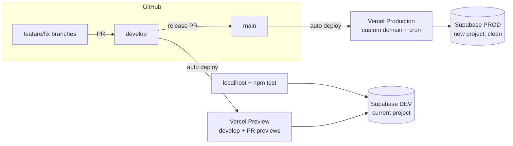

# Production Setup — Leather Shop

Plan for splitting today's single environment into a real production +
dev/staging setup before real customers arrive. Status: **planned, not
started** (2026-10-09). Step-by-step checklist lives in
[MANUAL_TASKS.md](./MANUAL_TASKS.md); this doc is the why and the shape.

## Why

Today there is one of everything:

- **One Supabase project** serves the live site, local dev, and
  `npm test`. Tests create real orders, decrement real stock, and create
  promo codes in the same database the live site reads, and
  `supabase/scripts/wipe_test_data.sql`/`seed_test_data.sql` have been run
  against it too — its contents are a mix of real and test data.
- **One branch.** Vercel's production branch is `develop`, so every merged
  PR ships to customers immediately — no place to check a change on real
  infrastructure first.
- **The GitHub repo is public** (MANUAL_TASKS.md had it recorded as
  private).

## Target

| | Production | Dev / staging |
|---|---|---|
| Git branch | `main` (new) | `develop` + PR branches |
| Vercel env | Production | Preview + Development |
| Supabase | **new project**, migrations `0001`–`0024`, real content entered via `/admin` | **current project**, kept as-is |
| Domain | custom domain | `*.vercel.app` preview URLs |
| Cron (`vercel.json`) | runs (Vercel only runs crons on production) | doesn't run |
| Who uses it | customers, owner's real admin work | `npm test`, local dev, trying changes |

## Decisions

- **New project = production, current project = dev** (owner's call,
  2026-10-09). Production starts from a known-clean state instead of
  inheriting test orders, test customers and wipe/seed leftovers.
  `.env.local` doesn't change — local dev and tests keep using the current
  project.
- **Start production clean — no data copied** (2026-10-09). Production
  gets the migrations only; the real catalog, photos, settings, payment
  methods, FAQ and homepage content are re-entered through `/admin`. The
  catalog is small (4 products today) and photos uploaded through the
  admin land in production Storage with correct URLs, so a copy script
  isn't worth it. No orders, customers or promo codes carry over.

## Migration seed data to clean up in production

Running `0001`–`0024` on an empty project isn't quite "empty" — some
migrations insert starter data:

- `0001` — two sample products, `classic-bifold-wallet` and `tote-bag`
  (plus their categories via `0014`). Delete or hide them in
  `/admin/products` once real products exist.
- `0006` — placeholder FAQ items. Rewrite them in `/admin`.
- `0003` — the admin allow-list entry (`marcolorenzoromero@gmail.com`).
  Keep it.
- `settings` rows get their defaults (shipping fee, delivery cities, hold
  duration, placeholder contact email, etc.). Every one needs checking in
  `/admin/settings` and `/admin/homepage`.
- `0004`/`0013` create the Storage buckets — nothing to do.

## Cutover

The production Vercel deployment can only point at one database, and the
real content is entered through the live `/admin`. So the switch is: point
production at the new project → redeploy → immediately enter content.
The storefront is briefly empty in between, which is acceptable
pre-launch. Do it in one sitting.

## Release flow (after setup)

1. Work lands on `develop` via PRs as today → auto-deploys to a Preview
   URL backed by the dev DB. Check it there.
2. If the release includes a new migration: run it on **dev** first (as
   today), then on **prod** right before step 3.
3. Open a PR `develop` → `main`, merge → Vercel deploys production.

Proposed CLAUDE.md wording change once done: tests run against the **dev**
Supabase project only; migrations get a "run on prod before the release
PR" step tracked in MANUAL_TASKS.md, alongside the existing "run on dev"
item.

## Open questions

- **Vercel plan.** Vercel's Hobby (free) plan is for non-commercial use
  per its terms; a shop taking orders is commercial. Pro is US$20/month.
  Worth checking which plan the project is on and deciding deliberately.
- **Supabase plan.** Free tier allows 2 active projects (prod + dev fits),
  but has no downloadable daily backups and pauses projects after a week
  of inactivity. The daily expiry cron probably keeps prod awake; the dev
  project pausing is harmless (restore it from the dashboard). Pro
  (US$25/month) adds daily backups — worth it once there's real order
  history to lose. Until then, take a manual `pg_dump` of prod before
  risky migrations.
- **Branch protection on `main`** (require a PR, no direct pushes) is
  free on public repos but needs GitHub Pro on a private one. Optional —
  it's a one-person repo.

## Follow-up for the developer agent (optional)

A guard so `npm test` refuses to run against production — e.g. a Vitest
setup check that aborts if `SUPABASE_URL` matches the production project
ref. Logged in [IMPROVEMENTS.md](./IMPROVEMENTS.md).
