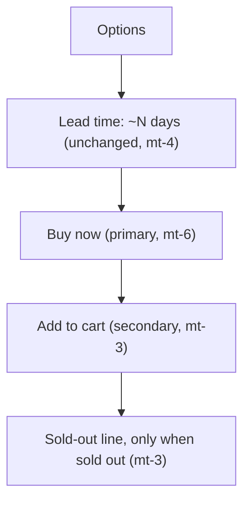

# Product Page: "Buy now" Button

**Status:** Approved by the owner, 2026-10-17. No mockup (the owner
chose brief-only). Being built on `design/buy-now` together with the
storefront button sweep ([buttons.md](buttons.md)).

**Agreed before drafting (owner):** Buy now adds this item, with the
selected options, to the cart and goes straight to `/checkout` with the
**whole cart**. There is no single-item checkout, and existing cart items
stay. If the same item with the same options is already in the cart, it
isn't added again (see Decisions). Buy now is the primary (dark) button. Add to cart becomes secondary,
in a tinted fill, not white and not a plain outline.

**Rev 2 (2026-10-17):** the owner moved storefront buttons from pills to
2px rectangles with uppercase tracked labels. Styling now points to
[STYLE_GUIDE.md § Buttons](STYLE_GUIDE.md#buttons), and the sitewide
rollout is in [buttons.md](buttons.md). Behaviour, layout and copy are
unchanged.

Extends the "Quiet & Confident" system (`STYLE_GUIDE.md`) and the product
page from `shop-page.md`. Unavailable wording follows
`featured-out-of-stock.md`.

## 1. Purpose

Give a shopper who has already decided a one-tap path from the product
page to checkout, without making browsers who want to keep shopping feel
pushed. Two buttons, one clearly leading, nothing louder than today.

## 2. Layout

**Stacked, full width, at every breakpoint** (recommended). The buy
column is roughly 450–500px on desktop, so side by side would give two
~220px buttons with long labels ("Going to checkout…"), and it would make
desktop and mobile behave differently. Stacking keeps one reading order
and one tap zone per row on a 375px phone.

- **Lead time** stays where it is, above the buttons, so it's read before
  committing.
- **Buy now** on top, **Add to cart** 12px below (`mt-3`), wrapped in one
  `flex flex-col gap-3` so both share the same width.
- **"Back soon — we're making more."** stays below the button area,
  centred, unchanged (it now sits under the single status block, see §4).

## 3. Styling

Both buttons follow [STYLE_GUIDE.md § Buttons](STYLE_GUIDE.md#buttons):
2px rectangles (`rounded-btn`), the Default size (`h-12`, 48px, full
width), and small uppercase tracked labels. Classes and states aren't
repeated here. The guide is the source.

| Element | Variant (STYLE_GUIDE § Buttons) |
|---|---|
| Buy now | **Primary**, solid ink, with the pending rule (stays full strength while navigating) |
| Add to cart | **Secondary**, sand `#E7E2D9`, ink text, 13.5:1 |
| Sold out / Currently unavailable | **Status block**, cream `#F3F1EC`, ink-soft text, 4.76:1, a `
` and not a button |

## 4. States

| State | Buy now | Add to cart |
|---|---|---|
| **Normal** (options pre-selected) | "Buy now", enabled | "Add to cart", enabled |
| **Just added** (via Add to cart) | Unchanged | "Added ✓" for 1.5s plus toast (today's behaviour) |
| **Navigating** (after tapping Buy now) | "Going to checkout…", disabled, `aria-busy="true"` | Disabled (secondary disabled style) until the page changes |
| **Paused** (`!orderingEnabled`) | Hidden | Replaced by the status block: "Currently unavailable" |
| **Sold out** (`!inStock`) | Hidden | Replaced by the status block: "Sold out", with the "Back soon" line below |
| **Missing option** | Not reachable today (see note) | Same |

- **One status, not two disabled buttons.** When ordering isn't possible,
  both buttons are replaced by a single full-width, non-interactive
  **status block** (STYLE_GUIDE § Buttons: cream, ink-soft, same
  rectangle). Render it as a `
`, not a disabled `<button>`. It reads as
  a quiet notice, not a broken CTA. It replaces today's 50%-opacity dark
  disabled button.
- **Navigating:** the label changes in the same tick as the tap. Both
  buttons lock, so a double tap can't add the item twice. Use
  `useTransition` around `router.push("/checkout")` so the pending state
  lasts until the checkout page renders.
- **Missing option:** options default to their first value, so this can't
  happen through the UI. The one edge is an option type with **zero
  values**, which today disables the button silently with no explanation.
  Hand-off: ignore empty option types in the `canAddToCart` check (there
  is nothing to choose), rather than designing an error state for it.

## 5. Feedback

- **Add to cart:** unchanged. "Added ✓" plus the "Added to cart" toast.
- **Buy now: no toast** (recommended). The immediate "Going to checkout…"
  label, followed by the checkout page showing the item in the order
  summary, is the confirmation. A toast would land on top of the
  checkout form and repeat what the page already shows.
- **Analytics:** Buy now fires the existing `add_to_cart` event with one
  extra property, `via: "buy_now"` (Add to cart sends `via: "add_to_cart"`).
  **No separate `buy_now` event.** A new event type means touching
  `track-event.ts`, `api/events/route.ts` and `lib/events.ts` for
  something the property already answers. `checkout_started` keeps firing
  where it does today.

## 6. Copy

| Element | Label |
|---|---|
| Primary | Buy now |
| Primary, pending | Going to checkout… |
| Secondary | Add to cart |
| Secondary, just added | Added ✓ |
| Status (paused) | Currently unavailable |
| Status (sold out) | Sold out |

Written in sentence case in the source, shown in small caps through the
`uppercase` class (STYLE_GUIDE § Buttons, label style), so screen
readers read normal words. All are four words or fewer. These are fixed
interface copy, not settings.

## 7. Accessibility

- **Focus order** follows the visual order: options → Buy now → Add to
  cart. No `tabindex` changes.
- Visible labels are the accessible names, so no extra `aria-label`.
  "Added ✓": add `aria-hidden` to the ✓ glyph (or label it "Added"), so
  screen readers don't announce "check mark".
- **Pending:** `aria-busy="true"` on Buy now. The label change is enough;
  the route change moves focus.
- **Status block:** plain text in a `
`, so it's read in flow, not
  announced as a dimmed control.

## 8. Out of scope

- Single-item or "express" checkout, or skipping the cart's other items.
- A quantity picker on the product page.
- Any change to `/cart`, `/checkout`, or the header cart count, beyond the
  sitewide button restyle in [buttons.md](buttons.md).
- Buy now on shop-grid or homepage cards (product page only).
- "Notify me when it's back" (already in `DESIGN_IMPROVEMENTS.md`).
- Restyling the option value pills or the dropdown here. They're
  handled by the button sweep ([buttons.md](buttons.md) → Decisions).

## Decisions (owner, 2026-10-17)

1. **Already in the cart:** if the same item with the same options is
   already in the cart, Buy now **doesn't add another**. It goes straight
   to checkout. The shopper can change the quantity there or in the
   cart. Otherwise it adds the item, then goes to checkout.
2. **Unavailable look:** approved. The quiet cream status pill replaces
   today's dimmed dark button for both paused and sold-out products.
