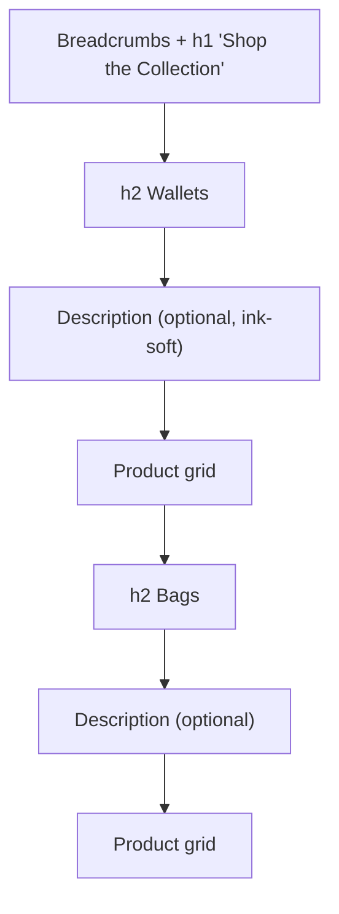

# Category Descriptions — Design Brief

Status: **Agreed** (owner, 2026-10-22). **Built on
`feat/category-descriptions`** (not yet committed): migration
`supabase/migrations/0028_category_descriptions.sql`;
`src/lib/category-description.ts`, `src/lib/admin/categories.ts`,
`src/lib/products.ts`, `src/app/admin/actions.ts`,
`src/app/admin/categories/page.tsx`,
`src/components/admin/CategoryFields.tsx`, `src/app/products/page.tsx`,
`src/app/products/ShopJumpNav.tsx`, `src/components/SiteHeader.tsx`
(measurement hook only); `tests/category-descriptions.test.ts`. Mockup (opens on
the agreed combination): <https://claude.ai/artifact/1c4mnb3gXu4Ligfjbxy6W7>
(logged in [DESIGN_LOG.md](../DESIGN_LOG.md)). The agreed layout below
**supersedes** the earlier "plain grey caption" treatment; see
§ Agreed layout.

Owner request: "I want to add descriptions on the product page for the
categories."

Builds on [shop-order.md](shop-order.md) (category sections on
`/products`, release 0.2.0) and [STYLE_GUIDE.md](STYLE_GUIDE.md)
("Quiet & Confident"). No new visual language.

## Purpose and audience

- **Shopper:** a short line under each category heading tells them what
  the group is about (the leather used, what it's for, how it ages)
  before they look at the cards. It sets the tone of the shop the way a
  shelf card does in a small boutique.
- **Owner (non-technical):** writes and edits these in the same place
  they already name and arrange categories, with no layout to manage.
  One plain-text field per category, optional.

## Where it shows

**Decided (owner, 2026-10-21):** on the **Shop page (`/products`)**,
directly under each category's `<h2>`, above that category's grid. The
individual product page (`/products/[slug]`) is not part of this
feature.



## Agreed layout

Chosen by the owner after comparing eight heading styles, a "lots of
products" view and three phone layouts in the mockup.

### Desktop (≥ 900px): Side rail

```
──────────────────────────────────────────────────────────── hairline
Bags                     [card]   [card]   [card]
Totes and crossbodies    [card]   [card]   [card]
cut from thick…          [card]   …
(pinned while this category's products scroll past)
```

- Each category is a two-column section: a left rail at 1/4 width
  holding the `<h2>` and description, and the product grid at 3/4 width,
  still **3 cards per row**. Grid gap 24px; column gap 40px.
- The rail is `position: sticky`. Its `top` must clear the site's sticky
  header (header height + ~24px), **not** `top: 24px` as in the mockup.
  It stays **pinned until its top reaches the top of the last row's
  photos** (owner, 2026-10-22), then scrolls away with the products, so
  it never slides down beside the last row's names and prices. The stop
  is measured in the browser from the last row (any number of cards in
  it) and re-measured on resize and as photos/fonts load. If the rail is
  taller than the room above that line, it just scrolls normally.
- A 1px hairline (`rgba(28,26,24,.12)`) above each section, 32px padding
  under it, 80px between sections.
- Heading: 22px, medium (500), `tracking-tight` (−0.02em).
- Description: 15px, ink-soft `#6E6A64`, `leading-relaxed`.
- A category without a description shows just the heading in the rail.
- Between 640px and 900px (tablet), the rail stacks above the grid as
  on phones, with the desktop type sizes.

### Phone (< 640px): Bold type

- Heading and description stack above a **2-per-row** grid.
- Heading: 28px, medium (500), −0.025em, `leading-tight`.
- Description: 15px, **ink** `#1C1A18` (not ink-soft), `leading-relaxed`,
  10px under the heading, 24px above the grid.
- A hairline above each category **except the first** (the sticky jump
  bar directly above it already has a line), 32px padding under it,
  64px between categories.
- **No coloured panel.** The cream band was tried and dropped by the
  owner.

### Jump links: on, names only

- A row of category names under the `h1`, linking to each section
  (`#category-<id>`). Small uppercase, 12px, medium, letter-spacing
  0.1em, ink-soft; the current/hovered one is ink with a 1px underline.
  **No product counts** (owner).
- Desktop: an inline row, 40px above the first section; click scrolls
  smoothly (instant under `prefers-reduced-motion`). Sections get a
  `scroll-margin-top` that clears the sticky header.
- Phone: the row becomes **sticky** just below the site header,
  scrolls sideways if it overflows (hidden scrollbar), has a white 94%
  background and a hairline under it, and **underlines the category
  currently in view** as the shopper scrolls.
- Rendered only when two or more categories have visible products.
- Accessibility: `<nav aria-label="Categories">`; the active link gets
  `aria-current="true"`.

### Not included

- No count label ("10 pieces") above headings.
- No cream band, no carousel, no centred or statement styles.

## States

| State | What the shopper sees |
|---|---|
| Category has a description | Heading, description, grid |
| Category has no description (blank/null) | Exactly today's layout: heading, then grid with `mb-6`. No placeholder text, no empty gap |
| Some categories have one, some don't | Each section follows its own row above. Mixing is fine, since the heading-to-grid rhythm stays even |
| Only one category has visible products | Heading and jump links are omitted (existing rule). If that category has a description, it shows as an intro line under the `h1` (description style, `-mt-4 mb-8` so it sits with the title), and the plain grid follows (no side rail) |
| Category with no visible products | Section doesn't render (existing rule), so its description doesn't either |
| Loading / error | No new states. It's server-rendered with the existing product query |

## Mobile

See § Agreed layout → Phone. It wraps naturally and needs no truncation
or "read more", because the 200-character limit keeps it short. Side
gutters are the page's existing `px-6`.

## Motion

Only the jump links' smooth scroll (instant under
`prefers-reduced-motion`). Nothing fades in.

## Admin: `/admin/categories`

Today each category row is an inline name input, a save icon and a
delete icon, plus the "N products · arrange" disclosure, inside a
draggable card.

**Recommended: match the FAQ admin pattern** (`src/app/admin/faq/page.tsx`).
Each row shows the category name plus a two-line preview of the
description, with an edit (pencil) icon that opens a `FormModal`
("Edit category") holding both fields. This keeps the drag list
compact as descriptions are added, and avoids a textarea inside a
draggable card. The alternative (an inline textarea under the name,
saved with the same save icon) is listed in Open question 3.

Row (recommended layout):

- Line 1: category name (`font-medium`, ink).
- Line 2: description preview, `line-clamp-2 text-sm` ink-soft; if
  empty, ink-soft "No description" so the owner can see which ones are
  missing (admin only, never shown on the shop).
- Right side: edit icon (`FormModal` `triggerVariant="icon-edit"`), then
  the existing delete icon.
- Below: the existing "N products · arrange" disclosure, unchanged.

"Edit category" modal and the "Add category" modal both get:

- **Name** (required, as today), with a visible label.
- **Description** (optional): labelled "Description (optional)",
  `textarea rows={3} maxLength={200}`, placeholder "A sentence or two
  shown under this category in the shop." Helper text below in
  ink-soft `text-xs`: "Up to 200 characters. Leave blank to show
  nothing." A live character counter is a nice-to-have, not required.

**Save feedback** (existing pattern, no new UI): the `FormModal` submit
runs through `runAction`/`ActionResult` to the toast.

- Success: modal closes, toast "Category saved." (edit) or "Category
  added." (add), same messages as today.
- Failure: modal stays open with the text kept, error toast, for
  example "Category name is required." or "Description must be 200
  characters or fewer."

## Data (for the developer)

- New migration `supabase/migrations/0028_category_descriptions.sql`:
  `alter table categories add column description text;` (nullable),
  plus `check (description is null or char_length(description) <= 200)`.
  No backfill. Every existing category starts with no description, so
  the shop looks exactly as it does today until the owner writes one.
- Save rule: trim; collapse internal newlines/whitespace runs to single
  spaces; an empty result is stored as `null`.
- This is per-category content edited in the admin, like the category
  name. It is not a shop-wide setting, so no `settings` key is needed.
- The 200-character limit is a design constant (layout-driven), not a
  business setting. Call it out at the point of use as the explicit
  exception, per CLAUDE.md.
- The storefront product query needs the category description so the
  shop sections (`ShopSection` from `groupProductsByCategory`) can carry
  it.
- **Existing gap to fix alongside:** `updateCategoryAction` and
  `createCategoryAction` only revalidate `/admin/categories` and
  `/admin/products`, not the storefront. A renamed category (and a new
  description) won't appear on `/products` until something else
  revalidates it. Both should also call `revalidateStorefront()`, like
  the reorder actions do.

## Out of scope

- The individual product page (`/products/[slug]`). The owner placed
  descriptions on the Shop page only.
- Rich text, links or images in descriptions; per-category hero photos
  or banners.
- Category landing pages (`/shop/wallets`), filter chips.
- Using the description as SEO meta text.

## Decisions

1. **Placement (owner, 2026-10-21):** descriptions show on the Shop
   page (`/products`) under each category heading, and not on the
   individual product page.
2. **Layout (owner, 2026-10-22):** desktop Side rail, phone Bold type,
   jump links on (names only, sticky on phones), no count label. See
   § Agreed layout.
3. **Length (owner, 2026-10-22):** up to 200 characters, enforced in
   the admin with a live "n / 200" counter.
4. **Only one category (owner, 2026-10-22):** its description shows as
   an intro line under "Shop the Collection".
5. **Admin editing (owner, 2026-10-22):** name and description are
   edited together in a pop-up, like FAQ items.
6. **Copy (owner, 2026-10-22):** the owner writes their own in the
   admin. Nothing is seeded; blank categories show no description.
