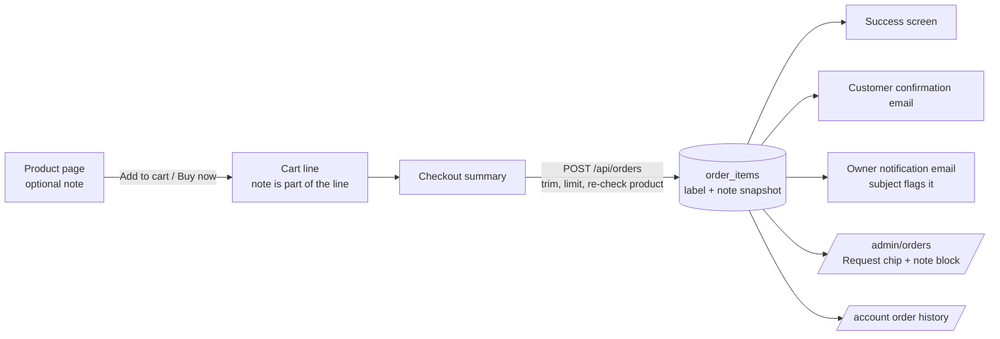

# Custom Requests on the Product Page — Design Brief

Status: **Agreed** (2026-11-01; drafted 2026-10-22). The owner took every
recommendation in the questions below. Branch `feat/custom-requests`.
Ready to build.
Mockup: <https://claude.ai/artifact/5TJQZP9sRZsfttvWbmnydc> (logged in
[DESIGN_LOG.md](../DESIGN_LOG.md)).

Owner request: "add a customization option to a product page for client
requests."

Builds on [STYLE_GUIDE.md](STYLE_GUIDE.md) ("Quiet & Confident"),
[buy-now.md](buy-now.md) (Buy now / Add to cart rules),
[option-buttons.md](option-buttons.md), [checkout.md](checkout.md),
[order-success.md](order-success.md),
[cart-account-concept.md](cart-account-concept.md) and
[admin.md](admin.md). No new visual language.

## Owner decisions so far

| # | Question | Answer (owner) |
|---|---|---|
| 1 | What kind of customisation? | A **free-form request note** ("navy thread, slightly longer strap"). The owner reads it and confirms by hand. Not monograms with rules, not priced add-ons. |
| 2 | Does it cost extra? | **No extra charge** at checkout. The note travels with the order; the owner quotes separately if a request needs it. |
| 3 | Which products? | **Chosen per product**: a toggle on the product's admin page, with an owner-editable label and helper text. Default label "Special request". |
| 4 | Required? | **Optional** for the shopper. |
| 5 | Default label (A) | **"Special request"**. |
| 6 | Line under the box (B) | **One shop-wide setting** `custom_request_note` on `/admin/settings`. |
| 7 | Edit a note in the cart (C) | **No, read-only** in v1. To change it, remove the line and add it again. |
| 8 | Length limit (D) | **300 characters, fixed** (a stated design-constant exception). |
| 9 | Owner email subject (E) | **Yes**: add the "· has a request" suffix. |
| 10 | Requests turned off mid-cart (F) | **The order goes through with the note**. Never dropped silently. |

## Purpose and audience

- **Shopper:** a handmade shop's best feature is that a person makes the
  piece. The field says "you can ask" without turning the page into a
  configurator. It should read like a line on an order slip, not a form
  section. Most shoppers will leave it blank, and the page must look
  finished when they do.
- **Owner (non-technical):** turns it on for the pieces they're happy to
  adjust, writes one short label and hint in their own words, and must
  **never miss a request** once an order comes in. Missing one means
  making the wrong item by hand, which is the costliest mistake in a
  one-person workshop.

## How the note travels



## Look and feel

Same as the rest of the product page: Archivo, ink and ink-soft text,
hairline borders, 2px corners (`rounded-btn`). No accent fill, no box
around the section, no icon. The field is one more row in the column of
choices, styled like the existing dropdown option field so it reads as
part of the same list. On the admin side, the note gets the **Warning**
semantic colour (brass ochre `#8A6415`), the one place in the admin that
already means "look at this".

## 1. Product page (`/products/[slug]`, `ProductDetail.tsx`)

**Shown only when** the product has requests turned on **and** can be
ordered (`canOrder`). A sold-out or paused product shows no field; there
is nothing to attach it to.

**Order in the column** (only the new rows are bold):

1. Name, price, description, Product Details (unchanged)
2. Option types: dropdowns and the brown option buttons (unchanged)
3. **Special request field** (new, `mt-6` like each option)
4. Lead time line (unchanged, stays next to the buttons because a
   request can affect it)
5. Buy now, Add to cart (unchanged)

**Anatomy of the field:**

| Part | Content | Style |
|---|---|---|
| Label row | `{label}` + "Optional" | Label `text-sm font-medium` (same as option names); "Optional" `text-sm` ink-soft after a space. Written in the label element, so screen readers hear "Special request, optional". |
| Helper text | `{help}`, the product's own hint | `mt-1 text-sm` ink-soft, max ~60ch. Omitted when blank. |
| Textarea | Multi-line, `rows={3}`, `maxLength={300}`, `resize-y` | `mt-2 w-full rounded-btn border` hairline, `bg-transparent px-3 py-2`, **`text-base`** (16px: anything smaller makes iOS Safari zoom in on focus). Focus: border ink + `focus-visible:outline-2 outline-offset-2 outline-[#1C1A18]`. |
| Placeholder | "e.g. Navy thread, strap 2 cm longer" | Default browser placeholder colour on the textarea. Carries an example only, never instructions (it disappears once typing starts). |
| Footer row | Expectation line (left), counter (right) | `mt-2 flex justify-between gap-4 text-xs` ink-soft. Counter `tabular-nums flex-none`. |
| Expectation line | Shop-wide setting, default: "We'll confirm the details by email before we start, including any change to price or timing." | See § 6 and decision B. |
| Counter | `n / 300` | Ink-soft until 270, then ink (`#1C1A18`) and `font-medium`. At 300: "300 / 300 · Limit reached". No red: the limit is a hard stop (`maxLength`), so it is never an error state. |

**Behaviour:**

- The note is kept in local component state. It is **not** cleared after
  Add to cart, so adding the same item twice with the same note bumps
  that line's quantity (same as options today). The "Added to cart" toast
  is unchanged.
- Pasting more than 300 characters gets cut at 300 by `maxLength`. The
  counter then shows "Limit reached", so the cut is visible.
- No validation message on the product page: an empty note is valid, and
  the length can't be exceeded.

**Character limit: 300, a stated design-constant exception** (like the
200-character category descriptions). Reasons: it bounds the cart line
layout and the admin order card, it's enforced by a DB `check`, and a
request longer than ~3 sentences is a conversation, which belongs in
the follow-up email the expectation line already promises. If the owner
wants it adjustable later, it can move to `settings` without a design
change. Call it out in code at the point of use (per CLAUDE.md).

## 2. Cart (`/cart`, `CartView.tsx`, `cart-context.tsx`, `cart.ts`)

**Line identity includes the note.** The key becomes slug +
selectedOptions + normalised note. So:

- Same product, same options, **different notes** → two separate lines,
  each with its own quantity stepper and remove button.
- Same product, same options, **same note** (after trimming) → one line,
  quantity bumps.
- **No note** behaves exactly like today, and old saved carts (no note
  field) still load and match.

**Display on the line**, below the option rows and above the price:

```
Saddle Tote
Colour: Tan
Special request: Navy thread, and the strap
2 cm longer than standard if possible…  Show all
₱6,800
```

- `{label}: {note}`, using the label the product had when it was added
  (stored on the cart line). `text-sm`, label in ink, note in ink-soft,
  `whitespace-pre-line` so the shopper's line breaks show.
- Clamped to **2 lines** (`line-clamp-2`). If it overflows, a "Show all"
  text button (accent, `text-sm`, 44px tap area via `py-3 -my-3`) expands
  it in place, and it then reads "Show less". No modal.
- **No editing in the cart** (decided for v1: C). To
  change a note, the shopper removes the line and adds it again from the
  product page. A small fix later can be emailed, because the owner
  confirms every request anyway. Editing would need merge rules when an
  edited note matches another line, which is more work than it's worth
  now.

**Buy now:** works as today with the note as part of the identity. If
the cart already has this product + options + note, nothing is added and
it goes straight to checkout. Otherwise it adds a new line (it never
bumps an existing one) and goes to checkout with the whole cart.

**Checkout summary** (`CheckoutForm.tsx`): the same `{label}: {note}`
row under the options in `text-xs` ink-soft, clamped to 2 lines with the
same "Show all" button. The summary column is narrow, so the clamp
matters more here.

## 3. After ordering

The order keeps a **snapshot** of the label and the note on each order
item (like option names today), so renaming the label later never
changes past orders.

| Where | Treatment |
|---|---|
| **Success screen** ("What you ordered") | Under the item's options: `{label}: {note}` in `text-xs` ink-soft, full text (no clamp; it's the receipt), `whitespace-pre-line`. |
| **Customer confirmation email** | Text: an indented line `  Special request: Navy thread…` under the options. HTML: one more grey row under the option rows, escaped with `escapeHtml`, `white-space:pre-line`. |
| **Owner notification email** | Text email. Subject gets a suffix: `New order #3f9a2c1e — ₱13,850 · has a request`. In the body, under the item: `  >> REQUEST: Navy thread…` so it stands out in plain text. |
| **`/admin/orders`** | See below. |
| **`/account` order history** | Same row as the options under the item, `text-sm` ink-soft, full text. |

**`/admin/orders` order card (most important):**

- A **"Request" chip** next to the order ref in the card's top line:
  `text-xs font-medium` brass ochre `#8A6415` on `rgba(138,100,21,.10)`,
  `rounded-md`, like the admin's other status chips. It shows on any
  order with at least one note, so the owner can spot it while scrolling.
- Under the item that carries it, a **note block**: `mt-1 border-l-2
  border-[#8A6415] pl-3`, eyebrow "CUSTOMER REQUEST" (`text-xs
  font-medium uppercase tracking-[0.08em]` brass), then the note in
  **ink** `text-sm whitespace-pre-wrap`, full text, never clamped. Ink
  rather than ink-soft because the owner has to act on it.
- The eyebrow is fixed admin copy ("Customer request"), not the
  product's label, so it scans the same on every order.
- Order search should also match note text, so the owner can search
  "navy". This is cheap if search is client-side over loaded orders.

**Escaping:** the note is plain text everywhere. React escapes it by
default. The HTML emails go through `escapeHtml`. No Markdown, no links
turned into anchors, never `dangerouslySetInnerHTML`.

## 4. Admin product edit (`/admin/products/[id]`, Details tab)

A new group at the bottom of `ProductFormFields`, above "Save changes",
separated by a hairline (`border-t pt-4`), titled **"Special requests"**
(`text-sm font-medium`):

1. **Checkbox:** "Let customers add a special request". Default **off**
   for every product, new and existing.
2. **Label** (input, max 40): default value "Special request". Hint:
   "Shown above the box on the product page."
3. **Helper text** (textarea `rows={2}`, max 160, live "n / 160" counter
   via the existing `CharCountTextarea` with a hard limit): default
   "Thread colour, strap length, a small change — tell us what you'd
   like." Hint: "Optional. A short example of what you can adjust."
4. One ink-soft line under the group: "Shown only while ordering is
   enabled. Requests appear on the order in Orders."

Label and helper stay visible and editable when the box is unticked
(simplest to build, and the owner can prepare the copy before switching
it on). A blank label saves as "Special request". A blank helper means no
helper line.

**Save feedback:** this is part of the existing Details form, so it uses
the existing `ActionForm` and the "Product saved." toast. Errors come back
as toasts: "Label must be 40 characters or fewer." / "Helper text must be
160 characters or fewer."

The "Add product" modal does **not** show these fields (it's a separate
short form, not `ProductFormFields`). A new product starts with requests
off, the default label and the default helper text, and is set up on its
Details tab.

## 5. States

| State | What shows |
|---|---|
| Product without requests | Nothing. The page is exactly as today. |
| Requests on, product sold out / paused | No field (status block as today). |
| Field empty | Placeholder, counter `0 / 300`. |
| Near limit (≥ 270) | Counter in ink, medium weight. |
| At limit | "300 / 300 · Limit reached". |
| Cart line, no note | Exactly as today. |
| Cart line, short note | One or two lines, no "Show all". |
| Cart line, long note | Clamped to 2 lines + "Show all" / "Show less". |
| Order placed, product turned off since | Note kept (it's a snapshot). |
| Requests turned off **between** add-to-cart and checkout | Order goes through **with** the note (decided: F). The owner still sees it on the order and can reply. Never dropped silently. |
| Note over 300 on the server (hand-edited cart) | 400: "Your request for {Product} is too long (300 characters max)." |
| Admin order, no notes | No chip, no block. |

No loading state is needed: the field is local, and the order request
already has its "Placing order…" state.

## 6. Settings vs. constants

| Value | Where it lives |
|---|---|
| Enabled / label / helper | **Per product** (product columns, admin-editable). |
| Expectation line under the field | **Shop-wide setting** `custom_request_note` on `/admin/settings`, default above. It describes the owner's process (by email, quotes first), which can change. (decision B.) |
| 300 / 40 / 160 character limits | **Design constants**, stated exceptions (layout-driven + DB checks), like the 200-character category description. |
| "Optional", "Show all", "Limit reached", "Customer request", the "has a request" subject suffix | Fixed interface copy. |

## 7. Accessibility

- `<label htmlFor>` on the textarea. The label text includes "Optional".
- `aria-describedby` = helper + expectation line + counter.
- The visible counter is **not** a live region (announcing every
  keystroke is noisy). A visually hidden `aria-live="polite"` region
  speaks only at "30 characters left" and "Character limit reached".
- "Show all" is a real `<button aria-expanded>` that controls the note's
  id. With the clamp, screen readers still read the full text (CSS clamp
  only hides it visually), so the button is for sighted users.
- Contrast: ink-soft on white 5.3:1; brass `#8A6415` on its 10% wash is
  about 5.0:1; ink note text 17:1.
- 16px textarea text, 44px tap targets for "Show all".

## 8. Mobile

- Single column, as today. The field is full width; `rows={3}` is about
  96px, so Buy now stays reachable with the keyboard closed.
- The footer row wraps: the expectation line takes the full width and the
  counter drops to its own right-aligned line under 360px wide
  (`flex-wrap`).
- Cart: the note row sits in the text column next to the thumbnail. The
  2-line clamp keeps the stepper row from drifting far down.

## 9. Motion

None. "Show all" expands instantly. No transitions on the counter.

## 10. Out of scope

- Pricing, surcharges or quotes inside the shop (owner quotes by email).
- File uploads / reference photos.
- A per-request approval workflow (accept/decline states, holds on
  payment until confirmed). The owner confirms by email, as today.
- Structured personalisation (monogram letters, fonts, placement rules).
- Editing a note after the order is placed (the owner can reply to the
  confirmation email).
- Requests at the order level (one note for the whole order). This is
  per item.
- Dark mode (shelved site-wide).

## 11. For the developer (flags, not a spec)

- **Products:** `custom_request_enabled boolean not null default false`,
  `custom_request_label text null` (null → "Special request"),
  `custom_request_help text null`. `check` limits 40 / 160.
- **Order items:** `custom_request_label text null`,
  `custom_request_note text null`,
  `check (custom_request_note is null or char_length(custom_request_note) between 1 and 300)`.
- **Settings:** `custom_request_note` text with the default above.
- **`create_order` (migration 0026, atomic) must carry both fields** into
  its `order_items` insert (`p_items[].custom_request_label`,
  `p_items[].custom_request_note`). That means a new migration that
  redefines the function and keeps 0024's grant lockdown. Don't add a
  second write after the RPC; it must stay one transaction.
- **Normalisation (server, and the same helper on the client for the
  cart key):** CRLF → LF; strip control characters except `\n`; trim each
  end; collapse 3+ newlines into 2 (keep single and double line breaks);
  empty → `null`. Count length after normalising. Line breaks are kept
  because a shopper may list two changes on two lines.
- **Route (`/api/orders`):** reject a normalised note over 300 (message
  in § 5). Accept a note even if the product has since turned requests
  off (decided: F). Take the label from the **product on the
  server** (its current label, or the default), never from the client.
- **Cart:** `CartItem` gains optional `customRequest?: string` and
  `customRequestLabel?: string`. `serializeOptions`/`isSameCartLine`
  include the normalised note. `sanitizeCart` accepts a missing note and
  drops non-string ones. `removeItem`/`setQuantity` and the React list
  keys need the note too, or two same-product lines collide.
- **Analytics:** `add_to_cart` gets `hasRequest: boolean`, never the
  text.
- **Read paths:** `ORDER_SELECT`, `OrderItem`, the row mapper, both
  emails, success screen, `/account`, `/admin/orders`.
- **Tests (`tests/`):** normalisation; cart identity (same note merges,
  different notes split, old cart without the field); route rejects
  disabled/too-long notes; `create_order` stores the note and cleans up.
  Manual click-through steps go in `docs/MANUAL_TESTING.md`.

## Resolved questions (owner took all recommendations, 2026-11-01)

Kept for the reasoning behind each decision. The answers are rows 5–10
of the decisions table at the top.

**A. Default label.** "Special request" (your suggestion), "Personal
touches", or "Make it yours"?
*Recommendation: "Special request".* It's plain, it sets the right
expectation (you'll ask, they'll confirm), and you can rename it per
product anyway.

**B. The line under the box** ("We'll confirm the details by email before
we start, including any change to price or timing."): one shop-wide line
you edit in Settings, or part of each product's helper text?
*Recommendation: one shop-wide line in Settings.* It's a promise about
how you work, so it should say the same thing on every product, and you
only edit it once.

**C. Editing a note in the cart.** Let shoppers edit it there, or keep it
read-only (remove and add again to change)?
*Recommendation: read-only for now.* You confirm every request by email
anyway, so a typo is easy to fix. Editing in the cart can come later if
shoppers ask for it.

**D. Length limit.** 300 characters (about three sentences)?
*Recommendation: 300, fixed.* Enough for "navy thread, strap 2 cm longer,
no logo stamp". Anything longer is better as an email conversation.

**E. Your new-order email.** Add "· has a request" to the subject line
when an order includes one?
*Recommendation: yes.* You'll see it in your inbox list before you open
the email.

**F. If you switch requests off for a product while a shopper has a note
for it in their cart:** stop the order with a message asking them to
re-add the item, or let it through with the note (you'd still see it)?
*Recommendation: let it through with the note.* It's rare, and turning
away a paying customer over it is worse than reading one extra note.
(The draft assumes this. If you'd rather stop the order, checkout would
say: "{Product} no longer takes special requests. Remove it from your
cart and add it again.")
