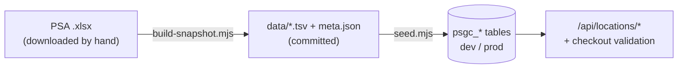

# PSGC address data

The checkout and saved-address forms use cascading dropdowns
(region → province → city/municipality → barangay) built from the
**Philippine Standard Geographic Code (PSGC)**, published by the
Philippine Statistics Authority (PSA). The data is a **bundled snapshot**
in this folder, loaded into four reference tables (`psgc_regions`,
`psgc_provinces`, `psgc_cities`, `psgc_barangays`, created by migration
`0025_nationwide_delivery_psgc.sql`). There's no live third-party API, so
there's no uptime or cost risk.

Source acknowledgement, as PSA's terms of use require: *Philippine
Standard Geographic Code (PSGC), Philippine Statistics Authority.*

## What's bundled

| | |
|---|---|
| Release | **2Q 2026**, PSA publication date **30 June 2026** |
| Source file | `PSGC-2Q-2026-Publication-Datafile.xlsx`, sheet `PSGC` |
| SHA-256 | `31892bc2bdde3ea0682562d9412b5bab4d45a0be5e5a5b4f6c9d7714b94bca5d` |
| Rows | 18 regions · 84 provinces · 1,642 cities/municipalities · 42,010 barangays |
| Size | about 1.4 MB of TSV in `data/` |

[`data/meta.json`](./data/meta.json) records the same facts for the
current snapshot and is the source of truth if this table drifts.

**How it was obtained.** PSA publishes the file at
<https://psa.gov.ph/classification/psgc>. That site sits behind a
browser check that blocks scripted downloads, so this copy was taken
unmodified from a public GitHub mirror
(`github.com/aivangogh/ph-address`, `assets/PSGC-2Q-2026-Publication-Datafile.xlsx`).
The workbook's own metadata (title, PSA as originator, "Publication
date: 30 June 2026") and PSA's internal "2026 June\Posted" save path both
match an official PSA release. The `.xlsx` itself isn't committed (3.2 MB
binary). Only the derived TSVs are, plus the hash above, so anyone can
re-download the file and check it.

## Files



- `build-snapshot.mjs`: turns a PSA `.xlsx` into `data/`. It touches no
  database.
- `derive.mjs`: the rules for PSA's quirks: Metro Manila has no
  provinces, highly urbanized cities are filed under their geographic
  province, and the City of Manila's sub-municipalities are folded in. It
  fails loudly on anything new rather than mis-filing it.
- `xlsx.mjs`: a tiny dependency-free `.xlsx` reader.
- `seed.mjs`: loads `data/` into a database.
- `tests/psgc-snapshot.test.ts` checks the snapshot and these rules
  without touching any database.

## Seeding a database

Run migration `0025` first. The seed is safe to re-run: it upserts every
row, then removes codes that are no longer in the snapshot.

```sh
# dev (uses .env.local)
node --env-file=.env.local supabase/psgc/seed.mjs

# prod: values from Supabase · prod → Project Settings → Data API / API Keys
SUPABASE_URL="https://<prod-ref>.supabase.co" \
SUPABASE_SERVICE_ROLE_KEY="<prod service_role key>" \
node supabase/psgc/seed.mjs
```

It prints the target host first. Check that it's the database you meant.

**After any re-seed**, the location lists are cached: a day in each
browser, and up to a week at Vercel's edge (`src/lib/locations-api.ts`).
So test in a private window, or with DevTools → Network → "Disable
cache" ticked. After a **prod** re-seed, also redeploy prod (Vercel →
Deployments → latest Production → Redeploy) to clear the edge cache.

## Refreshing to a newer PSA release

PSA updates PSGC quarterly, but changes are small (new barangays, renamed
or reclassified cities). The shop doesn't need every release. Refreshing
once or twice a year, or when a customer reports a missing barangay, is
plenty.

1. Download the newest "PSGC Publication Datafile" `.xlsx` from
   <https://psa.gov.ph/classification/psgc> in a browser.
2. `node supabase/psgc/build-snapshot.mjs ~/Downloads/PSGC-<quarter>-<year>-Publication-Datafile.xlsx`.
   If it stops with an error, PSA has added a new quirk. Update
   `derive.mjs` (and its tests), then re-run.
3. Run `npm test` (the snapshot tests run without a database). Review
   `git diff supabase/psgc/data` for anything surprising.
4. Update the "What's bundled" table above.
5. Run `seed.mjs` on dev, then on prod. No migration is needed.

Past orders and saved addresses keep their snapshotted names, so a
refresh never rewrites them. A saved address whose code PSA retired
fails the checkout check with "please pick again", and the customer
re-picks it.
